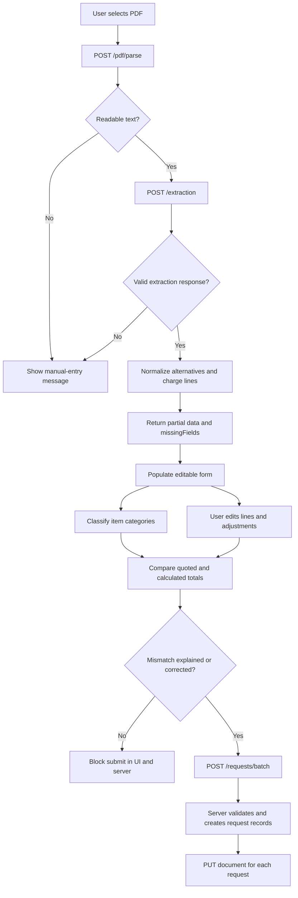
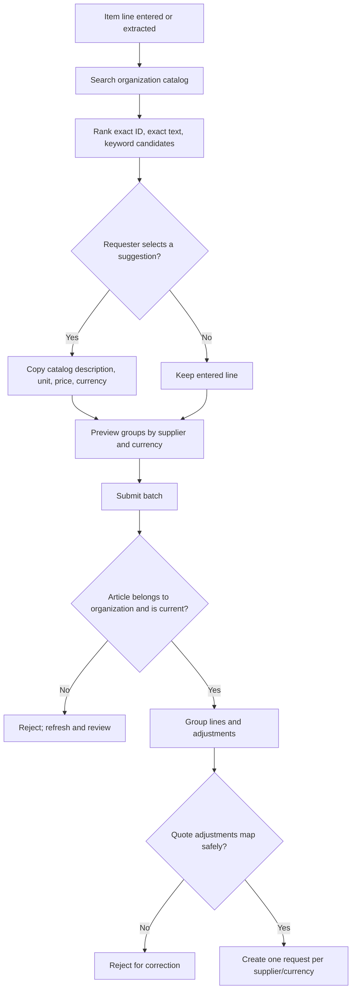
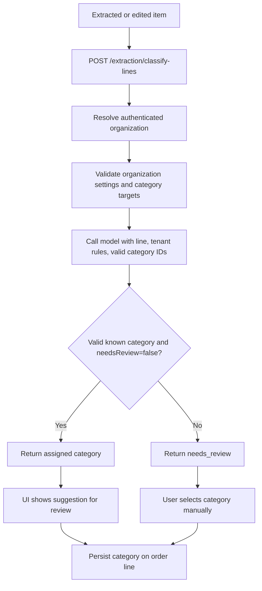
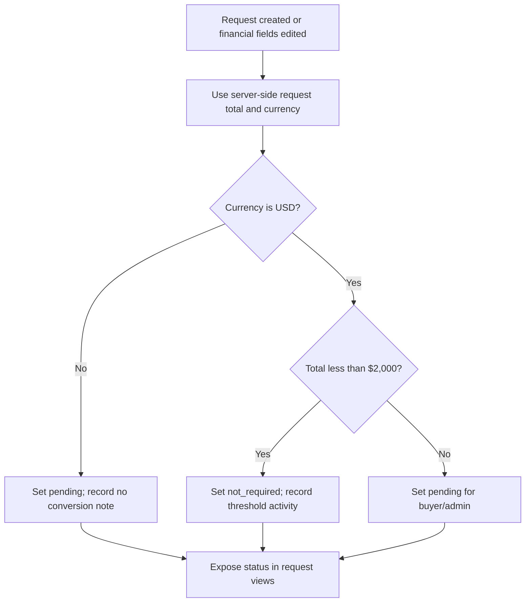

# Technical Fix Report

## Purpose and scope

This document is an engineering reference for the implementations associated with the four items in `code/case_requirements/`. It records the current implementation and its known boundaries; it is not a design specification for unimplemented behavior.

The main implementation areas are:

| Requirement | Main implementation |
| --- | --- |
| PDF extraction reliability | `backend/app/routers/pdf.py`, `backend/app/routers/extraction.py`, `backend/app/services/pdf.py`, `backend/app/services/extraction.py`, `backend/app/services/reconciliation.py`, `backend/app/routers/requests.py`, `frontend/src/app/dashboard/new-request/page.tsx` |
| Negotiated catalog pricing | `backend/app/services/article_matching.py`, `backend/app/routers/articles.py`, `backend/app/routers/requests.py`, `frontend/src/app/dashboard/new-request/page.tsx` |
| Custom commodity rules | `backend/app/schemas/organizations.py`, `backend/app/routers/organizations.py`, `backend/app/services/extraction.py`, `backend/app/seed.py`, `frontend/src/app/dashboard/organization/page.tsx` |
| Approval threshold | `backend/app/routers/requests.py`, `backend/app/models/procurement_request.py`, `backend/alembic/versions/0010_approval_threshold.py`, request and approvals pages in `frontend/src/app/dashboard/` |

## 1. PDF extraction reliability

### Implementation

#### PDF parsing and extraction

1. `POST /pdf/parse` accepts PDF MIME types, enforces a 10 MiB size limit, and extracts text from each page with `pypdf` (`backend/app/services/pdf.py`). The endpoint requires an authenticated user.
2. `POST /extraction` accepts up to 200,000 characters of extracted text. `extract_vendor_data()` calls the configured OpenAI chat model once with a JSON-only procurement extraction prompt. The configured model is read from application settings; calls have a 30 second timeout and one retry.
3. `ExtractedVendorData` and nested schemas normalize null or absent text and numeric fields to empty strings or zero. Invalid optional adjustment rows and non-object order-line rows are dropped where possible so one malformed AI field does not discard the full quote.
4. The response includes `success`, optional `data`, optional user-facing `error`, and optional `missingFields`. Missing title, supplier, tax ID, department, lines, or total is reported as reviewable data rather than a failed extraction.

The prompt asks for requestor and department separately, for item-level versus quote-level adjustments, and for the quoted line total rather than a recomputed line total. It also explicitly excludes alternatives and freight-like lines. The post-processing rules below provide a deterministic fallback for common labels.

#### Line normalization and alternative handling

`_exclude_alternative_lines()` removes line descriptions starting with `alternative`, `alt`, or `optional`, case-insensitively. It creates an old-index to new-index map and updates line-scoped adjustment indexes; adjustments attached to removed lines are discarded.

`_move_additional_charge_lines()` recognizes descriptions starting with `shipping`, `freight`, `delivery`, `transport`, or `handling`. Those rows are removed from the purchase lines and represented as quote-level `charge` adjustments using the extracted line total. It remaps the indexes of remaining line-scoped adjustments and avoids adding a duplicate when the model already returned a matching order-level charge by description and amount.

These rules operate on the extracted description prefix. They are not general semantic classifiers.

#### Financial representation and reconciliation

An adjustment consists of `kind` (`tax`, `discount`, `charge`), `description`, non-negative `amount`, `scope` (`line` or `order`), and optional zero-based `lineIndex`. The front end stores the adjustment list in form state and presents it in a collapsed HTML `<details>` section. It supports editing and adding/removing line-level and quote-level entries.

`backend/app/services/reconciliation.py` uses `Decimal(str(value))` and `ROUND_HALF_UP` to round money to cents. The total calculation is:

```text
sum(order line total_price)
+ sum(order-level tax and charge amounts)
- sum(order-level discount amounts)
```

Line-level adjustments are retained for review but excluded from the sum because the implementation treats the quoted line total as already containing those effects. `validate_adjustment_line_indexes()` rejects line adjustments that point outside the submitted lines.

The browser displays the calculated amount and compares it to the original quoted total. On `POST /requests/batch` (and the single-request path), `_validate_request_financials()` repeats the calculation server-side. An extracted quote whose quoted total differs from the calculated total needs a non-empty discrepancy note. The stored `financial_breakdown` JSON contains the adjustments, `calculatedTotal`, `quotedTotal`, and `hasMismatch`; `discrepancy_note` is persisted separately. Manual requests use the calculated amount as their total and do not reconcile against a quote total.

The UI keeps the quoted total as the request total when quote reconciliation is applicable, so the stated amount is visible and auditable. A user can resolve a mismatch by correcting the quoted value, the item/adjustment data, or by providing an explanation. The server accepts a mismatch with an explanation; it does not verify the note's content.

#### Form validation and document retention

`frontend/src/app/dashboard/new-request/page.tsx` runs client-side checks for requestor, title, conditionally required supplier/tax ID, department, item descriptions, units, currency format, item category, and mismatch acknowledgement. The server independently enforces organization-configured required fields and financial consistency.

After `POST /requests/batch` returns, the browser calls `PUT /requests/{request_id}/document` for each created request and attaches the original PDF bytes. The server stores the file in `RequestDocument` and records a `document_attached` activity. Because upload follows request creation, a document upload failure can leave a valid request without its attachment; the UI reports this as a warning.

### PDF-to-request workflow



### Example

For a quote with a $15,000 machine, $2,000 delivery, $1,402.50 tax, and an $18,402.50 grand total, extraction should provide one machine line, a quote-level delivery charge, and a quote-level tax. Reconciliation calculates `$15,000 + $2,000 + $1,402.50 = $18,402.50`. If delivery is mistakenly retained as a purchased line as well as an adjustment, or the tax amount is missing, the mismatch is shown and submission requires a correction or explanation.

### Technical decisions

- Keep parsing, model extraction, deterministic post-processing, UI review, and server-side financial validation as separate stages.
- Treat extraction as a suggestion. Persisted request data comes from the user's reviewed form, not directly from the AI response.
- Keep the vendor-stated total separate from the calculated total so the original quote amount is not silently overwritten.
- Use decimal rounding in the server calculation rather than binary floating-point arithmetic.
- Store adjustment details as JSON on the request, avoiding a new adjustment table for this implementation.
- Upload the source PDF after creating the request, since the batch operation can create multiple request records from one quote.

### Current limitations and issues

- `pypdf` text extraction does not perform OCR. Scanned image-only PDFs may return no usable text.
- AI extraction is one model call over extracted text; table layout may already be lost. There is no document-specific extraction pipeline or guaranteed result for all five supplied PDFs.
- Alternative and shipping detection is prefix-based. A label in the middle of a description or a synonym outside the configured patterns may not be caught.
- The system checks the grand total but does not enforce `quantity × unit price ≈ line total` for each line.
- A missing or incorrectly extracted tax or discount can still pass if the user supplies a discrepancy note. Note presence is checked; its quality or approval is not.
- Line-level adjustments are displayed and saved but do not affect reconciliation. This relies on item totals already reflecting line-level tax and discount.
- A quote containing multiple currencies is not converted into one comparable amount. The batch endpoint separates generated requests by currency, and the form stops comparing a single quote total when multiple request groups are present.
- After request creation, PDF attachment is a separate call and is not part of the request transaction.
- PDF extraction failures are returned as a generic extraction envelope, but `/pdf/parse` still has specific HTTP errors such as invalid file type, oversized file, and parse failure.

## 2. Negotiated catalog prices

### Matching and suggestion API

`GET /articles/suggestions?search=...&limit=...&offset=...` requires an authenticated organization membership. `article_matching._rank_articles()` always filters by `membership.organization_id`, then creates normalized tokens using Unicode folding, case-folding, simple suffix trimming, stop-word removal, and a small alias table (`notebook → laptop`, `docking → dock`, `ea → piece`, etc.).

Matching candidates receive one of these types and scores:

| Match | Score |
| --- | ---: |
| Exact normalized article number | 1.00 |
| Exact normalized description | 0.99 |
| Partial article-number match | 0.90 |
| Shared keyword match | `0.7 × query coverage + 0.3 × article-description coverage` |

Results sort by descending score and then article number. The API returns supplier, article number, description, unit price, unit, currency, match type, score, matched terms, and pagination totals. It exposes the reason for ranking rather than presenting the score as semantic confidence.

The request form searches each line automatically and allows a separate per-line search (`CatalogSuggestions` component). Selecting an article saves its identifier and a snapshot of the user's original line values in local form state. The selected article supplies description, unit price, unit, and currency; quantity is retained and the line total is recalculated. The selected price/description/unit/currency inputs are locked while the catalog choice is active. Clearing the choice restores original line values, adjusting the total if the quantity changed in the meantime.

### Request grouping and server validation

The form previews groups keyed by supplier identity plus currency. When `POST /requests/batch` is called, the server:

1. Confirms all selected article IDs belong to the current organization.
2. Loads the current catalog records and suppliers.
3. Rejects stale selections with HTTP 409 if description, unit price, currency, or unit no longer match the values submitted by the browser.
4. Uses the server-side article/supplier values to build each catalog-backed line.
5. Groups lines by supplier and currency. Non-catalog lines remain with the original quote supplier, unless exactly one selected supplier has the same normalized name, in which case they join that supplier group.
6. Moves line-scoped adjustments with their source line and updates their group-local line indexes.
7. Places quote-level adjustments with the original supplier only if that supplier maps to exactly one generated group and its currency matches the source quote currency. Otherwise it rejects the batch with HTTP 422, asking for correction.
8. Creates all grouped requests in a database transaction. If any group fails validation or persistence, it rolls back the batch.

For the single unchanged extracted quote with no catalog choices, the original quoted total is preserved and reconciled. For catalog selection or a split, each generated request total is calculated from its own line totals and assigned adjustments. The original quoted total/currency and split count are retained as metadata in the financial breakdown for context.

### Catalog selection and supplier-split workflow



### Example

A quote has two lines from the original supplier. The requester selects a catalog laptop from Supplier A and a catalog dock from Supplier B, leaving a cable as quoted. The preview indicates separate supplier requests. If the original quote supplier is Supplier A, the non-catalog cable can join Supplier A when the supplier-name match is unambiguous. Quote-level tax, discount, or delivery remains with the original supplier's group. Line-specific adjustments follow their own item. The endpoint creates both requests atomically or creates neither if the selected catalog data is stale or the adjustments cannot be allocated.

### Technical decisions

- Keep matching deterministic, explainable, and tenant-filtered rather than introducing embeddings or a second AI call.
- Treat catalog selection as optional; the original quote line remains valid when no article is selected.
- Revalidate catalog data at creation time to prevent stale or client-tampered price/supplier values.
- Use supplier ID and currency for grouping; supplier names are only used to map original free-text lines to a selected supplier when that mapping is unique.
- Keep supplier-split creation in one database transaction to avoid a partial set of requests.

### Current limitations and issues

- Token and alias matching is not semantic search. Synonyms, reordered phrases, and product attributes may be missed unless they share normalized words.
- Candidate selection in the ranking layer uses SQL substring checks against article descriptions and article numbers; rank scoring happens only after that candidate filter.
- The app does not validate physical-unit or currency comparability between an original line and a catalog line. Catalog fields are copied, but the requester chooses whether the article is appropriate.
- Quote-level adjustments are not allocated proportionally across supplier groups. They stay with the original supplier, and ambiguous or currency-mismatched cases are rejected.
- The request transaction and later PDF attachment are separate operations; a successfully created split batch can exist even if attaching the source PDF later fails.

## 3. Organization-specific commodity rules

### Configuration and storage

`Organization.settings` stores a JSON configuration. `OrganizationSettings` validates `required_fields` and `commodity_rules`. A rule has:

```json
{
  "id": "printer-toner-it-hardware",
  "guidance": "Book printer toner and toner cartridges in IT Hardware.",
  "commodity_group_id": 27
}
```

The schema limits the list to 100 rules, each rule ID to 80 characters, each guidance string to 2,000 characters, and combined guidance to 50,000 characters. IDs must be unique. The settings endpoint validates that every target category exists. Only an organization admin can update settings through `PATCH /organizations/me/settings`.

The seed logic adds Acme's rules if `commodity_rules` is not already set: cable ties/zip ties to Electrical Engineering, printer toner to IT Hardware, and small software/SaaS subscriptions to Office Supplies. Because rules live inside organization settings, they are tenant-scoped.

### Classification request lifecycle

`POST /extraction/classify-lines` uses authenticated organization membership to load the organization. `classify_order_lines()` loads the valid commodity groups and validated rules, then calls the configured model separately for each line with:

- the line description, total, and currency;
- this organization's rule guidance and target category names/IDs;
- all valid categories;
- a required JSON response shape containing a category ID and `needsReview` flag.

The system prompt treats the description as untrusted data, requests the most specific applicable rule, and asks for review when ambiguous. The response is accepted only if `needsReview` is a boolean false and the category ID is an integer that exists in the loaded category set. Invalid JSON, provider errors, nulls, unknown IDs, or uncertain output become `needs_review` with no assigned ID; provider failures are isolated per line.

The UI classifies extracted lines and can reclassify catalog-selected lines or all lines. `localId` and a per-line request counter prevent a late classification response from overwriting the line after the user has edited or removed it. Assigned categories are saved on each `OrderLine`, alongside `classification_source` (`llm`, `manual`, or `legacy`). A user can choose a category manually. The parent request retains a primary category selected from the line categories for compatibility with the existing request-level category field.

### Classification workflow



### Example

For `Black laser toner cartridge`, Acme's toner guidance and the valid `IT Hardware` category are sent with the line to the classifier. If it returns the valid category ID with `needsReview: false`, the UI shows it as an AI suggestion. The requester can still change it. If the provider is unavailable, the result is `needs_review`, and the request form requires a manual category before submit.

### Technical decisions

- Use organization JSON settings for flexible rule configuration and Pydantic validation at the API boundary.
- Provide category names and IDs, rather than trusting the model to invent category identifiers.
- Classify per line because a single request may have more than one accounting category.
- Fail closed to manual review when output is malformed, uncertain, or points to a category that does not exist.
- Keep category source metadata to distinguish AI-assigned, manually selected, and legacy line data.

### Current limitations and issues

- Rules are prompt guidance, not deterministic matching or overrides. There is no keyword/rule engine that guarantees cable ties, toner, or subscriptions receive the configured target category.
- A rule-triggered category change is not written as a separate audit event. The order line only stores the final category and source.
- “Small” software subscriptions has no amount or recurring-term threshold; the model interprets the prose rule.
- Admins edit the rules as JSON text in the organization settings UI. There is no rule simulator or structured rule builder.
- The classifier performs one model request per line, so latency and provider usage grow with the line count (the API allows up to 50 lines).

## 4. Approval threshold

### Decision logic

`APPROVAL_THRESHOLD` is `Decimal("2000.00")`. `_approval_decision(total_cost, currency)` rounds the amount with the shared money helper, uppercases the currency, and returns:

| Request amount | Currency | Result |
| --- | --- | --- |
| Less than 2,000.00 | USD | `not_required` plus an explanatory note |
| 2,000.00 or higher | USD | `pending` |
| Any amount | Non-USD | `pending` plus a note that it cannot be compared to the USD threshold |

The decision runs for each request created by both the standard and batch request endpoints. The automatically skipped case adds an `auto_approved` activity event with amount, currency, and threshold details. Non-USD creation adds an `approval_required` event.

On `PUT /requests/{request_id}`, financial changes are detected across total, lines, financial breakdown, or currency. `_reevaluate_approval()` recalculates status, clears `approved_by` and `approved_at`, and records the new decision in activity history. Non-financial edits do not recalculate approval. Existing records are not backfilled by migration `0010`.

Migration `0010_approval_threshold.py` permits the `not_required` approval status and adds nullable `approval_note`. The request list and detail views display “Approval not required”; the approvals queue includes pending records only.

### Approval workflow



### Example

A USD request totaling `$1,534.59` is saved with `approval_status=not_required`, an approval note, and an `auto_approved` activity entry. A `$2,000.00` USD request stays pending. If a buyer approves a `$1,900` request and a later edit changes its total to `$2,100`, the edit resets the approval to pending, clears the prior approver fields, and records that fresh approval is required.

### Technical decisions

- Define the boundary as strictly less than `$2,000.00`; exactly `$2,000.00` remains pending.
- Compare only USD requests because no exchange-rate source or conversion policy exists.
- Apply the check on the server so it also covers API requests that bypass the browser.
- Use `not_required` as a distinct approval state and keep a human-readable provenance note plus a structured activity record.
- Revoke prior approval metadata after an edit to financial values, requiring a new buyer decision when the updated request is over threshold.

### Current limitations and issues

- Non-USD requests always remain pending, even if their converted value would be below the threshold.
- Existing pending records are not automatically recomputed during migration. They are reevaluated when financial fields are edited.
- The edit handler recalculates after financial changes, but there is no background reconciliation job for out-of-band database edits.
- The threshold is a module constant rather than organization-configurable policy.

## Data and API reference

| Concern | Endpoint or storage |
| --- | --- |
| PDF text extraction | `POST /pdf/parse` |
| AI quote extraction | `POST /extraction` |
| Per-line category suggestions | `POST /extraction/classify-lines` |
| Catalog suggestions | `GET /articles/suggestions` |
| Batch/supplier-split creation | `POST /requests/batch` |
| Request financial edit | `PUT /requests/{request_id}` |
| Original quote attachment | `PUT /requests/{request_id}/document` |
| Organization settings | `Organization.settings` JSON; `GET/PATCH /organizations/me/settings` |
| Quote calculations and source context | `ProcurementRequest.financial_breakdown` JSON and `discrepancy_note` |
| Per-item category/catalog reference | `OrderLine.commodity_group_id`, `classification_source`, `catalog_article_id`, `catalog_article_number` |
| Approval outcome and rationale | `ProcurementRequest.approval_status`, `approval_note`, `RequestActivity` |

## Automated test references

These are the focused test modules associated with the fixes; this report does not record a test run for the current checkout.

| Coverage area | Test module |
| --- | --- |
| Partial extraction responses, safe extraction errors, missing API key/readable text | `backend/tests/test_extraction_reliability.py` |
| Alternative line removal, charge-line conversion, line-index remapping, deterministic totals and cent rounding | `backend/tests/test_reconciliation.py` |
| Organization-scoped matching, catalog selection validation, supplier splitting, adjustment routing | `backend/tests/test_catalog_workflow.py` |
| Rule schema validation, tenant isolation, valid/invalid model responses, provider failure fallback | `backend/tests/test_commodity_classification.py` |
| Request API behavior including total mismatch handling and approval status transitions | `backend/tests/test_smoke.py` |

